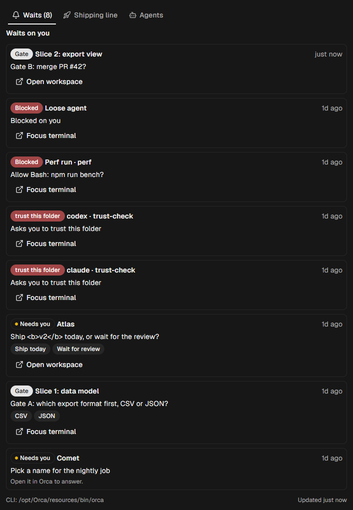
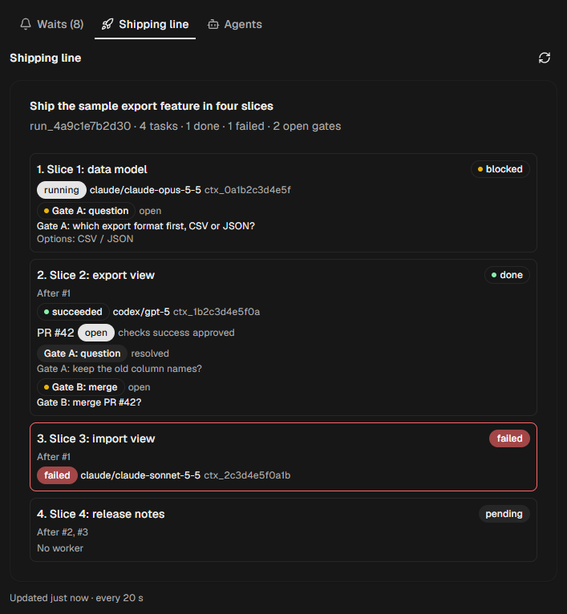
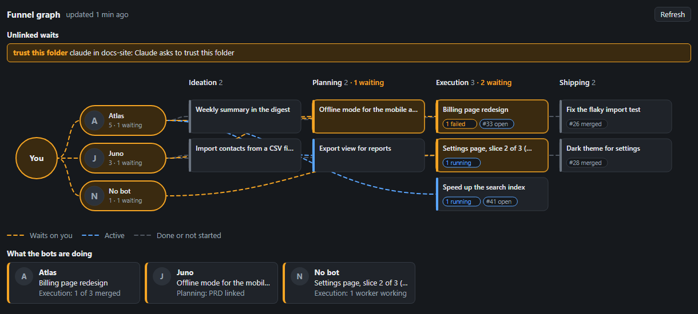

# Control Room

One [Orca](https://github.com/stablyai/orca) panel that answers two questions: **what waits on me**, and **where does each piece of work stand**. It works on Windows, macOS and Linux with no setup, and it is read only.

 



The screenshots show invented test data (`src/views/room/panel.check.ts`, `test/fixtures/cases/funnel-demo.json`), not a real account. The Funnel graph shot is the panel's own page drawn in a browser with that data, so each bot shows its initial instead of its picture. Light, Agents and Funnel tab shots wait on an Orca bug: `plugin shot --scenario` sometimes captures Orca's own window instead of the panel.

## What it shows

Control Room adds two panels: **Control Room**, with four tabs, and **Funnel graph**.

The Control Room panel has four tabs.

- **Waits.** Everything that waits on you, newest first: bot items set to *Needs you* (with the question and its options), open orchestration gates, and agents that are blocked or waiting. An agent stuck at Claude Code's or Codex's "Do you trust this folder?" prompt shows as **trust this folder**. Click a row to focus its terminal or open its workspace.
- **Shipping line.** Each orchestration Run, its tasks in build order, the worker on each task and its state, the pull request if there is one, and the gates (A: open questions, B: merge). Done tasks fold.
- **Agents.** Every agent in every workspace, grouped by project, with its state and how long it has been in it. This tab needs no Orca CLI, so it works even when the other tabs cannot read.
- **Funnel.** Each piece of work in its stage: **Ideation**, **Planning**, **Execution**, **Shipping**. One bot item is one piece of work. A Run with no item is its own piece. Work that waits on you is amber and comes first in its column, with the question, the gate or the failed worker. Open a card to see its tasks, workers, gates, pull requests and PRD. Click a card to open its wait, else the bot's home workspace, else a worker's terminal. Waits that belong to no piece of work show in an **Unlinked waits** row.

How the Funnel puts work in a stage (the latest stage wins):

| Stage | When |
| --- | --- |
| Ideation | An open item with no PRD, no Run, no worker and no pull request. |
| Planning | A PRD link or a Run, but no open pull request and no running worker. |
| Execution | An open or draft pull request, or a worker that is working. |
| Shipping | Every pull request merged or closed, at least one merged. A done item stays 7 days. |

A PRD is a `claude.ai/artifact/…` link in the item's links, then its description, then its Run's objective. Shipping means merged for now; deployed comes later.

**The Funnel graph panel** draws the same funnel as a picture: **You**, then each bot that owns work, then the four stage columns. Dashed wires join them: amber waits on you, blue is active, grey is done or not started. The wires stop moving when your system asks for reduced motion. Below the graph: a legend and **What the bots are doing**, one card per bot. Each bot shows its uploaded picture, else its Orca mascot, else its initial. Control Room ships no pictures: it reads them from your own Orca (`~/.orca/bots/<bot>/avatar.png`, and the mascots inside the installed Orca app). Each picture must be a real image of at most 128 KB, and an SVG must pass a safety check.

The Funnel tab and the Funnel graph read only while you see them: 2 CLI reads per bot every 20 s (closed items and the bot work list). Hidden, they read nothing.

A status bar item counts the waits. Each new wait shows one desktop notification, never twice. You can turn notifications off in the plugin's settings.

## Install

```sh
orca plugin install itsmanelvelasco/orca-control-room@main
```

Orca shows what the plugin asks for and prints an `--approve` command; run it to approve. Orca pins the install to one commit.

**To update:** run the same command again. Control Room has no `vX.Y.Z` tags yet, so `orca plugin update` keeps the pinned commit and never moves it. When an update adds a panel or access, Orca asks again: re-run with the `--approve` it prints. If Control Room is off, turn it on with `orca plugin enable itsmanelvelasco.control-room`.

Needs Orca 1.4.260 or later.

**Updating from a version without the Funnel graph panel:** the new panel changes the plugin's manifest, so Orca asks you to approve Control Room again before it loads. What it asks for (the access list below) does not change.

## Read only

Control Room never changes your bots, items, gates, Runs or terminals. It never answers a permission or trust prompt for you. The only actions are **open** (a workspace) and **focus** (a terminal).

- It runs at most 12 Orca CLI commands, all reads: `bot list`, `bot item list`, `bot work list`, `bot chats`, `worktree ps`, `automations list`, and `orchestration inbox`, `run-list`, `run-show`, `task-list`, `worker-list`, `gate-list`. Ids go into a command only after a pattern check. No free text reaches the command line.
- A test reads every source file and fails the build on a write command, a terminal write or send, or a host call that is not a read, an open or a focus.
- Text from bots, mail and agents is untrusted: Control Room cuts it to one line and shows it as plain text, never as HTML.
- The Funnel graph page runs only its own files under a strict content policy: no network, pictures only as `data:` images. It opens a pull request in your browser only for a `https://github.com/<owner>/<repo>/pull/<n>` link.
- No network, no telemetry, no dependencies.

What it asks Orca for, and why:

| Access | Why |
| --- | --- |
| `workspace:read` | List workspaces to find every agent. |
| `agent:read` | List agents and get their state changes. |
| `workspace:write` | Open a workspace and focus a terminal when you click a row. Nothing else. |
| `notifications:show` | One desktop notification per new wait. |
| `storage:own` | Remember which waits it already notified. |
| `settings:own` | The two settings below. |

## Settings

| Setting | Default | What it does |
| --- | --- | --- |
| Orca CLI path | empty | Full path to the `orca` CLI. Leave it empty: Control Room finds it. |
| Notify new waits | on | One desktop notification per new wait. |

## How it finds the Orca CLI

Bots, items, Runs, tasks, workers and gates come from the Orca CLI. Control Room tries these paths in order and never runs a bare `orca` from Orca's own folder:

1. The **Orca CLI path** setting, if set.
2. The CLI next to the running Orca app (`resources/bin/orca`, `orca.exe` on Windows).
3. The default install path:
   - Windows: `%LOCALAPPDATA%\Programs\Orca\resources\bin\orca.exe`
   - macOS: `/Applications/Orca.app/Contents/Resources/bin/orca`, then `~/Applications`
   - Linux: next to the AppImage, or `/opt/Orca/resources/bin/orca`
4. `orca` on `PATH`.

It runs the CLI with a clean environment: it removes `ELECTRON_RUN_AS_NODE`, and adds `APPDATA` and `LOCALAPPDATA` on Windows, or `HOME` on macOS and Linux, when they are missing. Each call has a 10 s timeout.

The footer of the Waits tab names the CLI path in use.

## Troubleshooting

- **"Orca CLI not found".** The banner lists every path it tried. Set **Orca CLI path** in the plugin's settings to the full path of the CLI. The Agents tab still works.
- **"The Orca CLI is not answering".** The banner quotes the CLI's error. Control Room keeps the last good data and retries after 4 s, 8 s, 16 s, up to 60 s.
- **The logs.** `orca plugin logs itsmanelvelasco.control-room` shows the CLI path and the time of one `bot list` call at start.

## Develop

TypeScript that Orca loads as it is: no build step.

```sh
orca plugin dev load .                       # run from source
orca plugin test .                           # the tests
bash scripts/ci-local.sh                     # the full gate
orca plugin shot . --panel control-room --scenario waits --theme dark   # a screenshot from test data
orca plugin dev unload .                     # when you are done testing
```

Every folder you load this way gets the same key, `local.control-room`. Two loaded folders clash, and a stale one can show a blank panel. Unload each folder when you are done testing; the error of `orca plugin dev request <folder> x` lists the folders that are loaded.

The test data in `test/fixtures/` is recorded CLI output with every name swapped for an invented one.

## License

[MIT](LICENSE)
